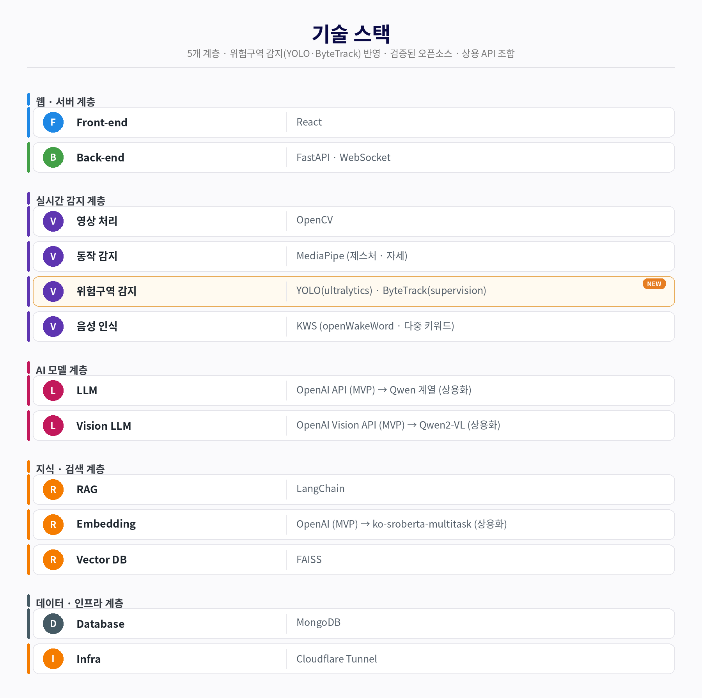
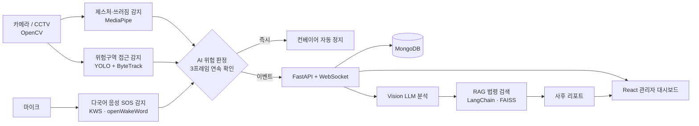
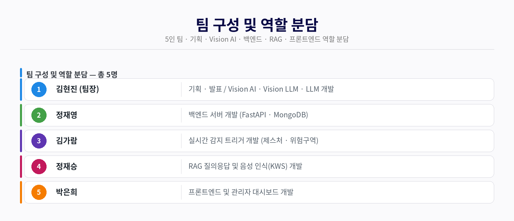

# 공장수호대 (FactoryGuard)

> 제스처·음성·위험구역 3중 AI 감지로 컨베이어 끼임 사고를 자동 정지하고, 사고 후에는 법령 근거가 붙은 리포트를 만드는 현장형 안전 시스템

2026년 제8회 K-디지털 트레이닝 해커톤 출품작 · 팀 공장수호대 (5인)

- Vision AI 모듈 상세 문서: [`vision-ai/app/README.md`](vision-ai/app/README.md)

## 왜 만들었나

컨베이어 끼임 사고(뚜안 2026, 김용균 2018, SPC삼립 2025)는 사람이 위험을 인지·판단·이동하는 시간(약 3~5초, 팀 추정)보다 빠르게(1~2초) 끝난다. 비상정지 버튼 위치의 문제가 아니라 사람의 반응 속도가 한계라서, AI가 사람 대신 판단해 설비를 멈추는 구조를 만들었다.

## 핵심 기능

| 기능 | 내용 |
|---|---|
| 3중 트리거 자동 정지 | 제스처(양팔교차·손흔들기 SOS·쓰러짐) / 음성(다국어 SOS) / 위험구역 접근, 어느 하나라도 감지되면 컨베이어 정지 (실측 약 0.6초) |
| 오탐 방지 | 3프레임 연속 확인(`ENTER_THRESHOLD_FRAMES=3`), ByteTrack 개인별 추적, 임계값 기반 판정 |
| 다국어 SOS | 한·영·중·베트남·태국 5개 언어 키워드 인식 (openWakeWord) |
| 사후 리포트 | 감지 이벤트 발생 시 Vision LLM 상황 분석 + RAG 법령 인용 리포트 생성 |
| 관리자 대시보드 | 감지 이벤트 실시간 로깅, 위험도별 분류, 통계 |
| 개인정보 보호 | 얼굴·이름 미저장, 익명 추적 ID만 사용, 이벤트 발생 시에만 스냅샷 저장 |

## 아키텍처





실시간 정지 경로(감지 → 판정 → 정지)와 사후 분석 경로(Vision LLM·RAG·리포트)는 분리되어 있다. RAG나 LLM이 느리거나 실패해도 정지에는 영향을 주지 않는다.

### 기술 스택

| 계층 | 항목 | 기술 |
|---|---|---|
| 웹·서버 | Front-end | React |
| | Back-end | FastAPI · WebSocket |
| 실시간 감지 | 영상 처리 | OpenCV |
| | 동작 감지 | MediaPipe (제스처·자세) |
| | 위험구역 감지 | YOLO (ultralytics) · ByteTrack (supervision) |
| | 음성 인식 | KWS (openWakeWord · 다중 키워드) |
| AI 모델 | LLM | OpenAI API (MVP) → Qwen 계열 (상용화) |
| | Vision LLM | OpenAI Vision API (MVP) → Qwen2-VL (상용화) |
| 지식·검색 | RAG | LangChain |
| | Embedding | OpenAI (MVP) → ko-sroberta-multitask (상용화) |
| | Vector DB | FAISS |
| 데이터·인프라 | Database | MongoDB |
| | Infra | Cloudflare Tunnel (MVP 시연용) |

MVP는 로컬 서버로 시연했고, 실제 현장 배포는 외부 노출 없이 공장 내부망만 쓰는 로컬 서버 구조를 기본으로 한다.

## 팀 구성



| 이름 | 역할 |
|---|---|
| 김현진 (팀장) | 기획·발표 / Vision AI · Vision LLM · LLM 개발 |
| 정재영 | 백엔드 서버 개발 (FastAPI · MongoDB) |
| 김가람 | 실시간 감지 트리거 개발 (제스처 · 위험구역) |
| 정재승 | RAG 질의응답 및 음성 인식(KWS) 개발 |
| 박은희 | 프론트엔드 및 관리자 대시보드 개발 |

## 저장소 구조

```
factoryguard/
├── README.md                프로젝트 소개 (이 문서)
└── vision-ai/               Vision AI · Vision LLM · 사후 리포트 모듈
    ├── app/                 YOLO 사람 탐지, 위험구역 판정, Vision LLM, 리포트 (상세: app/README.md)
    ├── tests/               단위·통합·오탐률 테스트
    ├── sample_data/         데모 영상
    ├── docs/                README용 다이어그램
    ├── key/                 API 키 템플릿 (openai_api_key.example)
    ├── run_demo.py          감지 데모 실행
    ├── run_report_demo.py   사후 리포트 데모 실행
    └── requirements.txt
```

백엔드·RAG·프론트엔드 등 다른 파트는 각 팀원의 브랜치에서 관리한다.

## 실행 (Vision AI 모듈)

```bash
cd vision-ai
pip install -r requirements.txt
cp key/openai_api_key.example key/openai_api_key   # 키 값만 한 줄로 입력

python run_demo.py                      # 데모 영상으로 파이프라인 확인
python run_demo.py --webcam             # 웹캠 실시간 감지
python run_demo.py --webcam --vision-llm  # Vision LLM 분석 포함
python run_report_demo.py               # 사후 리포트 생성 (RAG 서버 필요)
```

참고: 위험구역 시각화의 한글 라벨은 Windows 한글 폰트(`C:/Windows/Fonts/malgun.ttf`)를 사용한다. 다른 OS에서는 `app/core/danger_zone_detector.py`의 `_KR_FONT_PATH`를 해당 환경의 한글 폰트 경로로 바꿔야 한글이 깨지지 않는다.

상세 설정과 팀원 모듈과의 연동 방식은 [`vision-ai/app/README.md`](vision-ai/app/README.md)를 참고.
